   
    
  
 

👨‍💻 About Me
 
  
🎓 Currently pursuing MSc DC — Semester 1
💻 Interested in full-stack development, AI/ML, and software engineering
🧩 Practising problem-solving and strengthening my computer science fundamentals
🛠️ Learning by building projects and improving them step by step
🎯 Goal: create reliable, useful applications and grow as a software developer

 

🧰 Tech Stack
 
 

 

🚀 Featured Projects

 <table> <tr> <td width="50%" valign="top"> <h3>🌱 PlantGrowth AI</h3> 
An AI-focused project exploring plant analysis and model-powered predictions.
 
 
 
<a href="https://github.com/2007dhruv/plantGrowth-Ai"><b>View repository →</b></a>
 </td> <td width="50%" valign="top"> <h3>📁 File Management System</h3> 
A Laravel project to organise and manage file workflows.
 
  
 
<a href="https://github.com/2007dhruv/file-system"><b>View repository →</b></a>
 </td> </tr> <tr> <td width="50%" valign="top"> <h3>🧾 Quotation App</h3> 
A business-oriented application for managing quotation workflows.
 
 
 
<a href="https://github.com/2007dhruv/quotation-app"><b>View repository →</b></a>
 </td> <td width="50%" valign="top"> <h3>🧪 More projects</h3> 
Browse my repositories to see what I'm building and learning next.
 

 
<a href="https://github.com/2007dhruv?tab=repositories"><b>Explore all repositories →</b></a>
 </td> </tr> </table> 

 

📊 GitHub Activity
    
📈 Contribution Graph

🐍 Contribution Snake
<picture> <source media="(prefers-color-scheme: dark)" srcset="https://raw.githubusercontent.com/2007dhruv/2007dhruv/output/github-snake-dark.svg" /> <source media="(prefers-color-scheme: light)" srcset="https://raw.githubusercontent.com/2007dhruv/2007dhruv/output/github-snake.svg" />  </picture>
🏆 Trophies
 
 

🌱 Currently Focusing On

         
 

 

🤝 Let's Connect

 

  

  

